<p align="center">
  
</p>

<p align="center">
  <b>Собственная веб-панель для управления парком VPN-серверов</b> — разворачивайте ноды, выдавайте и отзывайте клиентские конфиги, следите за трафиком и здоровьем серверов из одного места. Замена ручному управлению серверами через десктоп-клиент AmneziaVPN.
</p>

<p align="center"><a href="README.md">English</a> · <b>Русский</b></p>

<p align="center">
  
  
  
  
  
</p>

<p align="center"><a href="CHANGELOG.md">Список изменений</a> · <a href="https://github.com/mihsergeev/amnezia-control/releases">Релизы</a></p>

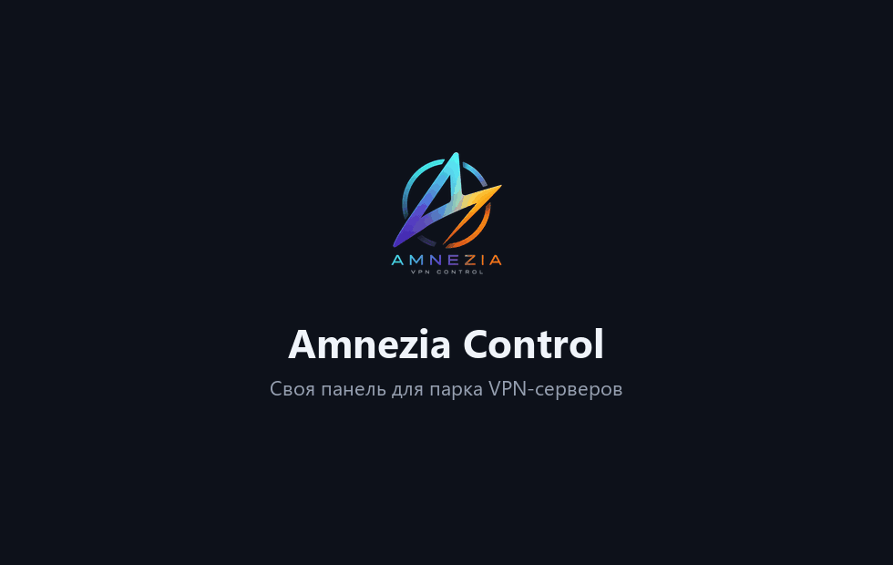

Ноды управляются по обычному SSH (агент на них не ставится). Поддерживаются четыре протокола сразу: **AmneziaWG**, **AmneziaWG 3.1**, **OpenVPN поверх Cloak** и **XRay / REALITY**. Клиенты выдаются в формате AmneziaVPN `vpn://` (со сканируемым анимированным QR), а для WireGuard еще и обычным `.conf`.

## Почему Amnezia Control

Настольный клиент [AmneziaVPN](https://amnezia.org) хорош для личного использования — поднять сервер, подключиться, поделиться доступом. Amnezia Control — для случая, когда у вас **несколько нод на команду** и управлять ими вручную перестаёт масштабироваться.

| Возможность | Desktop AmneziaVPN | Amnezia Control |
|---|:---:|:---:|
| Управление целым парком серверов | Частично | ✅ |
| Импорт существующих серверов (`vpn://` или списком) | ❌ | ✅ |
| Клиенты из одного интерфейса | ❌ | ✅ |
| Автоматическое истечение доступа | ❌ | ✅ |
| Пауза и возобновление клиента (без пересоздания) | ❌ | ✅ |
| Мониторинг трафика и состояния нод | ❌ | ✅ |
| Каскад из двух серверов: вход в одной стране, выход в другой | ❌ | ✅ |
| Проверка канала, которая видит замерзающий TCP и предлагает GRE | ❌ | ✅ |
| Алерты в Telegram и на вебхук (сервер, каскад, пропали клиенты, диск) | ❌ | ✅ |
| Снимки конфига и откат в один клик | ❌ | ✅ |
| Бэкапы по расписанию + восстановление | ❌ | ✅ |
| Audit log и 2FA панели | ❌ | ✅ |

**Чем отличается**

- **Сделана для сетей с фильтрацией.** Мастер каскада сначала проверяет канал между двумя серверами: если провайдер режет TCP в сеть выхода, он это покажет и предложит GRE-туннель. Сайты страны входа идут с него напрямую по геобазам, остальное уходит через выход в другой стране, а если выход упал, мимо него ничего не утекает.
- **Весь парк на одном экране.** Группы, поиск по имени, адресу, заметке и протоколу, фильтр проблем, нагрузка и диск ноды прямо в карточке. Выход каскада - часть своего входа и не засоряет список.
- **Алерты, на которые надо реагировать.** Короткие карточки в Telegram: что, где и почему в три строки. Короткие сбои отсекаются, один алерт на аварию и сообщение, когда она закончилась. Кроме упавшего сервера панель ловит то, что обычный мониторинг не видит: каскад, который перестал пропускать трафик, пропавших клиентов на ноде, адрес которой режут, смену SSH-ключа сервера.
- **На нодах ничего лишнего.** Панель работает по обычному SSH, без агента. Все, что она ставит (контейнеры протоколов, службы каскада), убирается из того же меню.
- **Безопасно в работе.** Снимки конфигов и откат, бэкапы по расписанию с самопроверкой, журнал действий, 2FA и пароль на опасные действия.
- **API для интеграций** с ключами, ограниченными по серверам: выдача и отзыв клиентов из своих систем.

> Независимый open-source-проект, не связан с [AmneziaVPN](https://github.com/amnezia-vpn/amnezia-client) и не является официальным продуктом.

---

## Возможности

**Серверы и ноды**
- Добавление серверов с онбордингом в одно действие (автонастройка по SSH-паролю или скрипт для запуска под root)
- Импорт уже развёрнутых серверов из ссылки AmneziaVPN «Полный доступ» (`vpn://`) или списком хостов
- Разворачивание AmneziaWG / AmneziaWG 3.1 / XRay / OpenVPN-over-Cloak на чистый сервер (сборка на самой ноде, с сохранением клиентов); занятый порт проверяется до начала установки, и окно сразу предлагает другой
- **AmneziaWG 3.1**: отдельный протокол рядом с 2.0 и legacy, свой контейнер, порт и подсеть, поэтому обе версии живут на одной ноде. Приложение AmneziaVPN подписывает такие подключения как "версия 3.1"
- **Обновление 2.0 до 3.1 на месте** (кнопка "Обновить до 3.1" на вкладке 2.0): тот же контейнер, порт, ключ сервера и подсеть, перед обновлением снимается снимок для отката. Клиенты 2.0 после этого не подключатся, их нужно перевыпустить. Ноды, поставленные еще на 3.0, переходят на 3.1 кнопкой "Пересобрать"
- AmneziaWG 3.1 собирается из исходников по закрепленным тегам и ставится в том числе на старый Docker (19.03 и ранние 20.10)
- **Каскад из двух серверов** (**+ Каскад**): клиенты подключаются ко входу в одной стране, а в интернет выходят с сервера-выхода в другой. Сайты страны входа (ее национальные домены и адреса) открываются со входа напрямую, остальное уходит с адреса выхода. Для России вход еще и отправляет через выход сайты, заблокированные в РФ. Мастер выбирает оба сервера (или добавляет новые), проверяет канал между ними и предлагает VLESS Reality или голый GRE-туннель для провайдеров, где TCP в сеть выхода замерзает. Дальше панель сама настраивает обе стороны: шлюз с геобазами на входе, туннель и выпуск в интернет на выходе, все службами systemd. Если выход пропал, трафик клиентов мимо него не утекает. В карточке виден маршрут, в меню **Ещё** - проверка канала, которая проходит путь (шлюз, туннель, интернет через выход) и отмечает каждый шаг, и **Разобрать каскад**. Своих клиентов у выхода нет, поэтому в списке пара видна одним сервером - входом
- Обновление серверного ядра в один клик; живой лог деплоя
- Мониторинг ресурсов ноды: загрузка CPU, RAM, диск, аптайм — прямо на карточке
- Группировка серверов в сворачиваемые **папки** — по компании, локации и т.п.

**Клиенты**
- Выдача / отзыв / перевыпуск конфигов по протоколам, с поиском, сортировкой и заметками
- **Переименование клиента** из его меню; новое имя пишется и на ноду, его видит приложение AmneziaVPN
- **Отзыв пачкой**: отметьте клиентов галочками и отзовите разом
- **Удаление протокола** с ноды вместе со всеми клиентами: в карточке сервера в меню **Ещё**, подальше от выдачи конфигов (по паролю; снимок конфига остается на ноде)
- Анимированный QR в том самом формате AmneziaVPN, который приложение реально сканирует, плюс обычный `.conf` для WireGuard
- **Конфиг одноразовой ссылкой** вместо файла в мессенджере: поставьте у себя [sup3rS3cretMes5age](https://github.com/algolia/sup3rS3cretMes5age) или [Password Pusher](https://github.com/pglombardo/PasswordPusher), добавьте его адрес в ⚙ → Ссылки на конфиги, и в окне конфига появится кнопка **Ссылка**. Ссылка открывается один раз и через 7 дней сгорает сама; в журнал пишется, кому отправлен конфиг, но не сам конфиг
- **Срок действия**: задайте клиенту срок (7 / 30 / 90 дней или своя дата) — фоновая задача сама отзывает его на ноде по истечении
- **История трафика по клиенту** (AmneziaWG и OpenVPN) — график скорости и накопленный объём
- **Топ клиентов по трафику** по всем серверам на дашборде
- **Блокировка торрентов** на сервере (галочка в "Изменить сервер"): в контейнерах AmneziaWG и OpenVPN режется торрент-трафик клиентов (рукопожатие пиров, DHT, HTTP- и UDP-трекеры). У того, кто качает, в списке клиентов появляется отметка "торрент", приходит алерт с именем клиента, не чаще раза в сутки. По желанию такого клиента панель сама ставит на паузу. Шифрованные торренты и трекеры по HTTPS могут пройти, клиентов XRay блокировка не касается

**Мониторинг и алерты**
- Дашборд «Обзор»: сводные графики трафика и онлайн-клиентов (24 ч), разбивка по серверам
- **Алерты о падении сервера** и **о нехватке места на диске** в Telegram и/или на вебхук, настройка из UI. Каждый алерт - короткая карточка: уровень, сервер, что случилось и строка подробностей. Алерты на русском или английском, язык выбирается в ⚙ > Алерты
- **Алерт "пропали клиенты"**: нода отвечает, но активных клиентов намного меньше, чем в это же время вчера и неделю назад. Так выглядит блокировка адреса ноды у провайдеров. Один алерт на просадку, по одному серверу не чаще раза в сутки, без сообщения "клиенты вернулись"
- **Алерт "каскад не работает"**: панель раз в 2 минуты проверяет каждый каскад со стороны входа и шлет алерт с причиной, если трафик через выход не идет 10 минут, а потом сообщает, что каскад снова работает

**Эксплуатация и безопасность**
- **Двухфакторная аутентификация (TOTP)** на вход в панель
- **Журнал действий** (кто и когда выдал / отозвал / развернул / удалил)
- **Бэкап и восстановление** БД (скачать архив или восстановить из него) + авто-бэкапы по расписанию с ротацией
- **Тёмная / светлая тема** и **русский / английский** интерфейс
- TLS и IP-whitelist на входе через метки `caddy-docker-proxy` (или свой реверс-прокси)

---

## Скриншоты

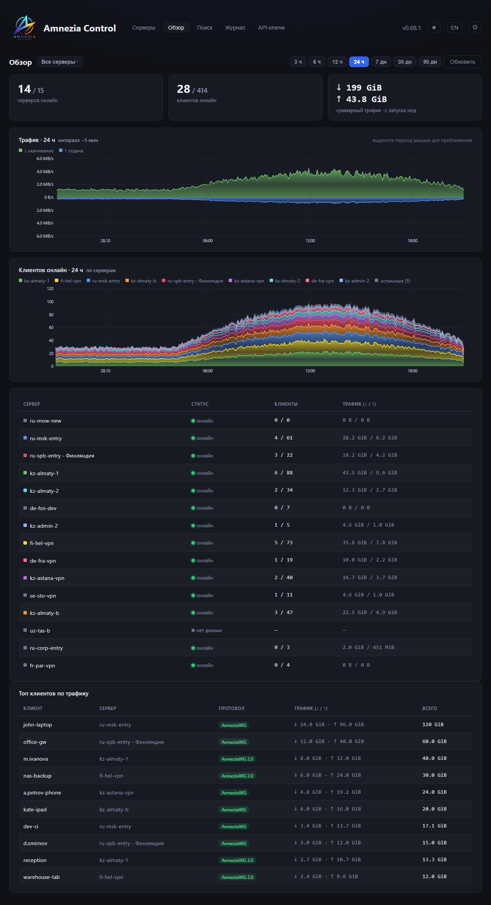

| Серверы (тёмная) | Серверы (светлая) |
|---|---|
| 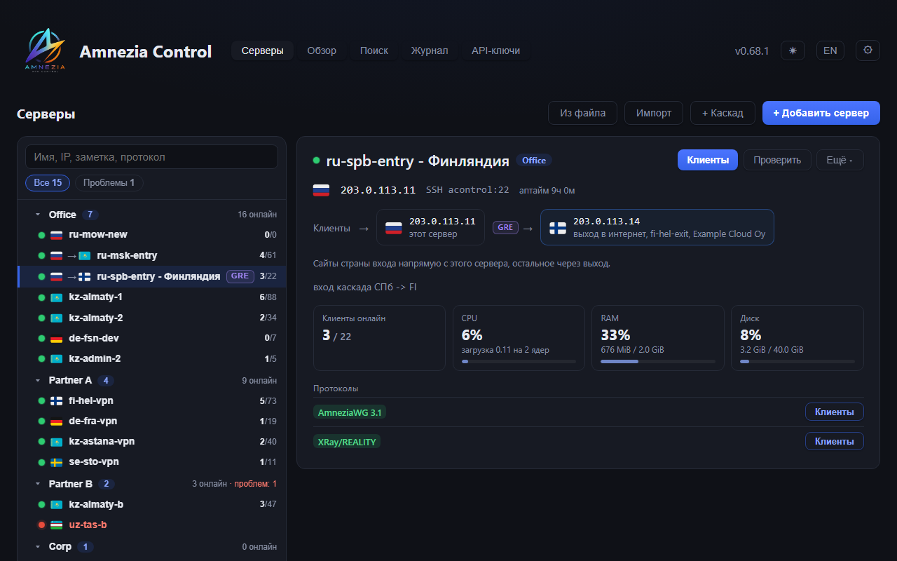 | 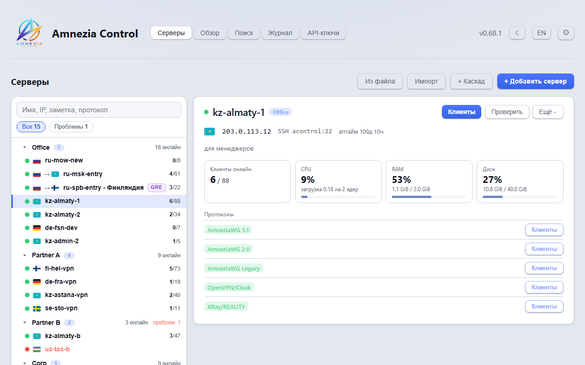 |

**Мастер каскада**: проверка канала видит, что TCP до выхода замерзает, и советует GRE; после установки панель показывает, откуда выходят клиенты:

| Проверка канала | Каскад собран |
|---|---|
| 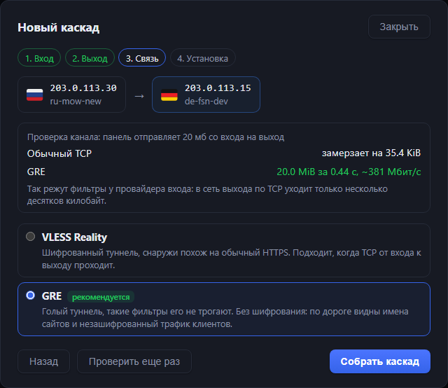 | 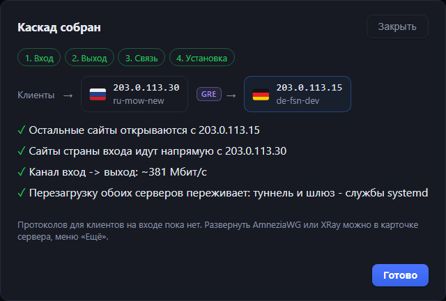 |

**Проверка работающего каскада** (Ещё > Каскад: проверить канал) проходит путь и отмечает каждый шаг; сломанный участок краснеет, а итог называет причину:

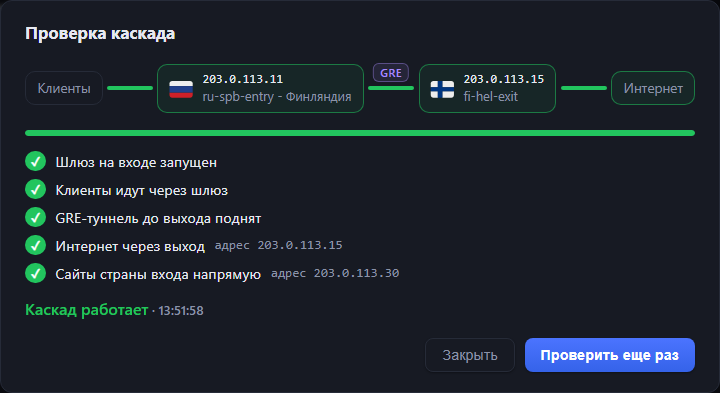

**Алерты в Telegram**:

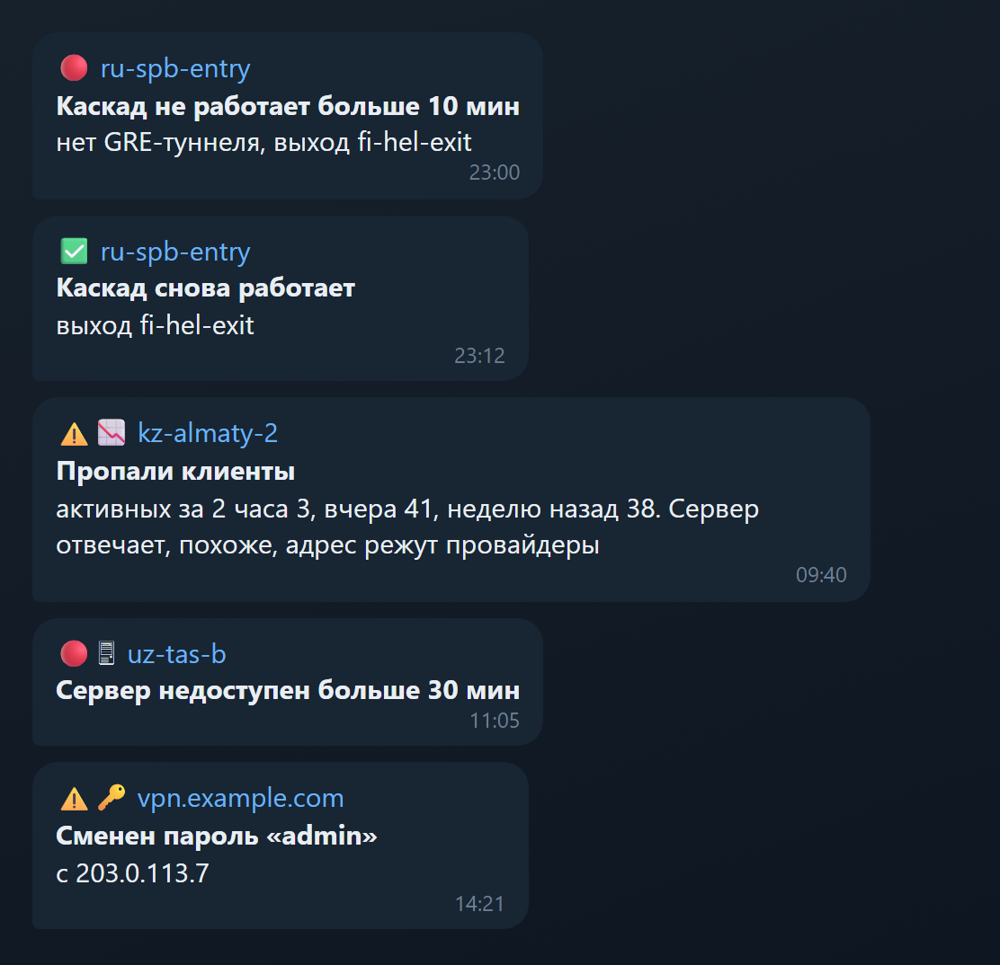

| Клиенты | Алерты о падении | Двухфакторная аутентификация |
|---|---|---|
| 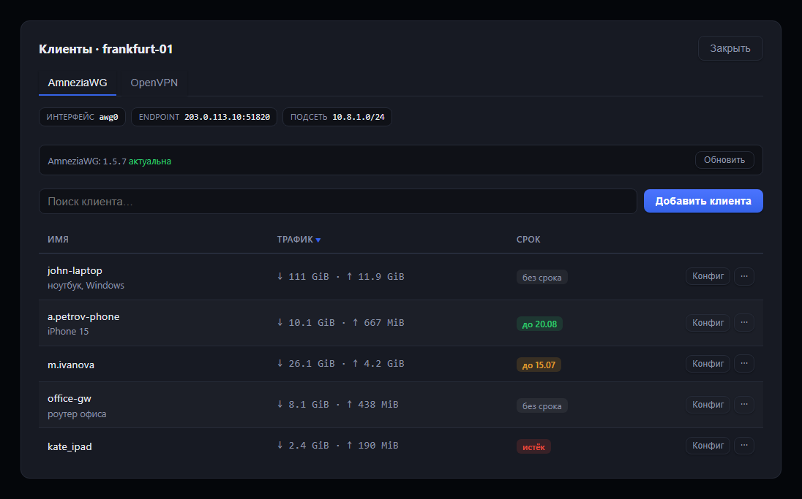 | 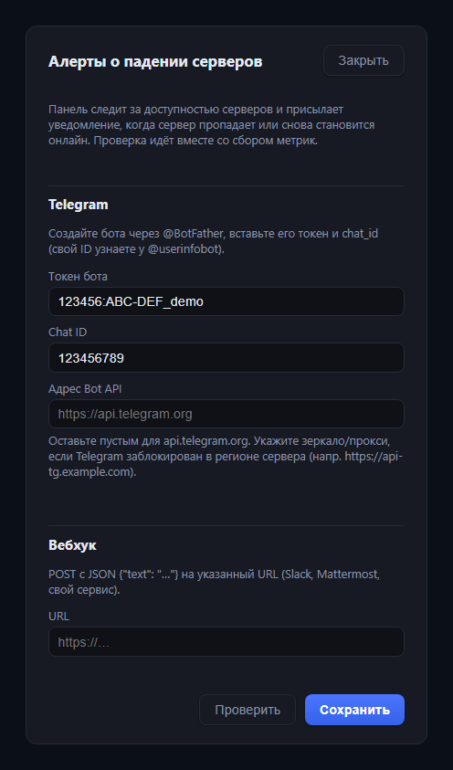 | 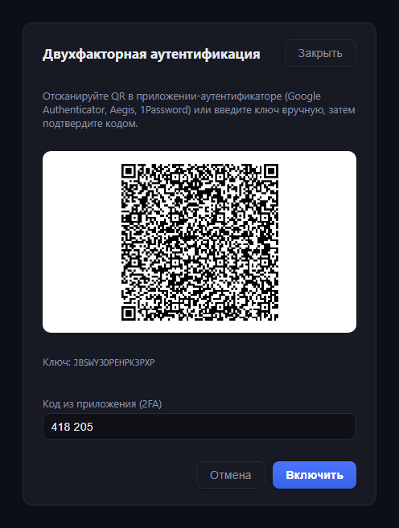 |

| Разворачивание протокола | Журнал действий | Импорт серверов |
|---|---|---|
| 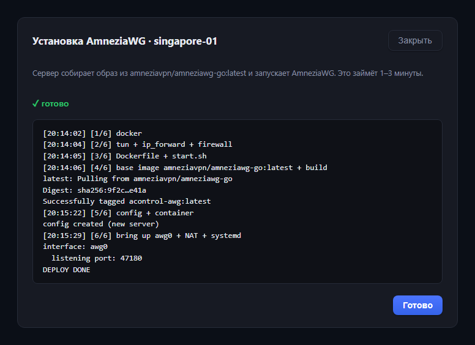 | 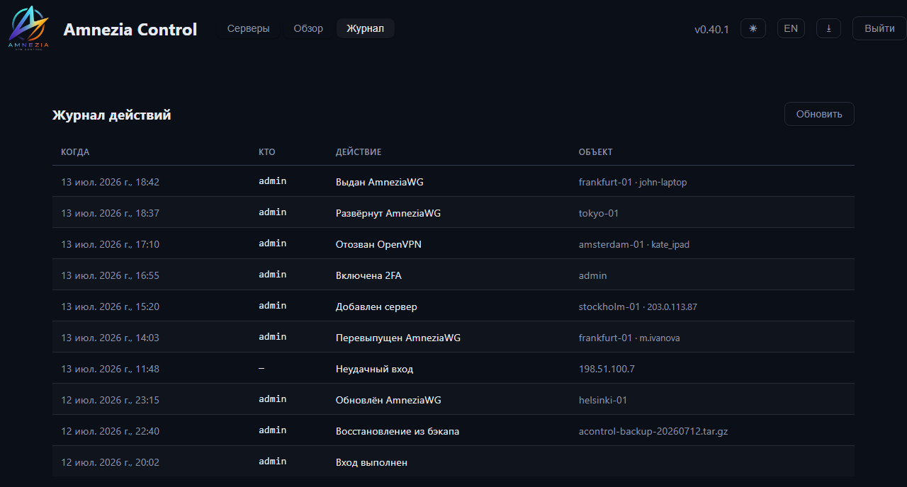 | 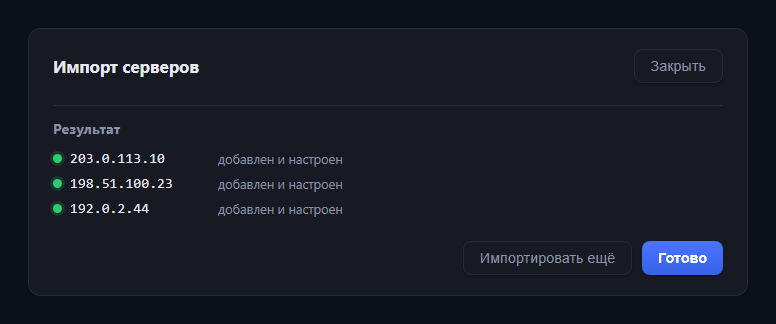 |

**Выдача клиентского конфига** — анимированный QR ровно в том формате, который сканирует приложение AmneziaVPN, плюс обычный `.conf` для приложений AmneziaWG / WireGuard:

| AmneziaWG `.conf` | Приложение AmneziaVPN (`vpn://`) |
|---|---|
| 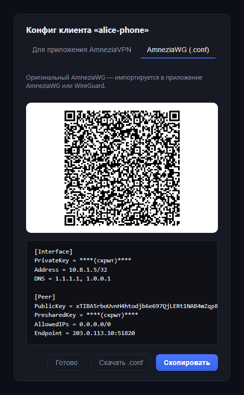 | 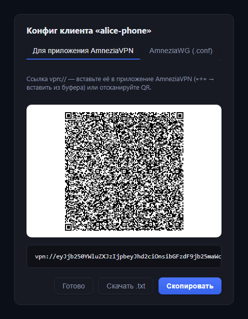 |

---

## Архитектура

- **Бэкенд** — Python 3.14, FastAPI, SQLAlchemy (async) + Alembic, управление нодами по SSH через `asyncssh`
- **БД** — PostgreSQL 18 (в тестах — SQLite)
- **Фронтенд** — React + Vite + TypeScript, SVG-графики без сторонних либ, без UI-фреймворка
- **Доставка** — Docker Compose на одном хосте; образы протоколов панель собирает *на самой ноде* из официальных базовых образов `amneziavpn/*` — по SSH уходит только крошечный скрипт

У панели свой SSH-ключ; к каждой ноде она подключается непривилегированным пользователем `acontrol` (доступ к docker через группу или `sudo`). Приватные ключи клиентов WireGuard/OpenVPN генерируются **на панели** — на ноду уходит только публичный ключ / CSR.

---

## Требования

- Linux-хост под панель с **Docker** и **Docker Compose** (v2)
- Реверс-прокси для HTTPS (nginx / Caddy / Traefik) — опциональный override под caddy-docker-proxy в комплекте
- VPN-**ноды**: Linux с Docker, доступные по SSH с панели

---

## Быстрый старт

> **Нужен** Docker Engine + плагин Compose. На чистом сервере: `curl -fsSL https://get.docker.com | sh`.

**Готовые образы (быстрее всего)** — multi-arch (amd64/arm64) образы публикуются в GHCR на каждый релиз, локальная сборка не нужна:

```bash
git clone https://github.com/mihsergeev/amnezia-control.git acontrol && cd acontrol
cp .env.example .env
# отредактируйте .env: задайте ACONTROL_ADMIN_PASSWORD, ACONTROL_DB_PASSWORD,
# ACONTROL_JWT_SECRET (openssl rand -hex 32) и ACONTROL_PANEL_IP
docker compose pull && docker compose up -d
```

**Сборка из исходников** — то же самое, но образы собираются локально:

```bash
docker compose up -d --build
```

Это **самодостаточный** режим: панель публикуется на хосте по адресу `ACONTROL_BIND` (по умолчанию `127.0.0.1:8080`). Откройте http://127.0.0.1:8080 или задайте `ACONTROL_BIND=0.0.0.0:8080`, чтобы открыть на всех интерфейсах. JWT-секрет удобно сгенерировать через `openssl rand -hex 32`. Закрепить версию можно через `ACONTROL_VERSION=` в `.env` (по умолчанию `latest`).

### HTTPS / реверс-прокси

Панель отдаёт обычный HTTP — **поставьте перед ней реверс-прокси с TLS**. Это админ-панель под логином, не выставляйте её в интернет по голому HTTP.

**HTTPS в один шаг (рекомендуется) — встроенный Caddy + бесплатный домен [sslip.io](https://sslip.io).** Свой домен не нужен: sslip.io превращает IP сервера в имя хоста (точки → дефисы: `203.0.113.10` → `203-0-113-10.sslip.io`), а встроенный Caddy сам получает для него настоящий сертификат Let's Encrypt.

```bash
# в .env — подставьте ПУБЛИЧНЫЙ IP своего сервера через дефисы:
#   ACONTROL_DOMAIN=203-0-113-10.sslip.io
#   ACONTROL_ALLOW_IPS=          # пусто = открыто всем (защита на логине + 2FA)
docker compose -f compose.yml -f compose.tls.yml up -d
```

Откройте `https://<ip-через-дефисы>.sslip.io`. **Порты 80 и 443 должны быть доступны** (по ним валидируется Let's Encrypt). Чтобы **ограничить доступ по IP** (остальным — 403), задайте вайтлист — но для «просто поднять» он не нужен:

```bash
# в .env:
ACONTROL_ALLOW_IPS=203.0.113.10 198.51.100.0/24
```

(либо впишите `COMPOSE_FILE=compose.yml:compose.tls.yml` в `.env` и запускайте просто `docker compose up -d`).

**Продвинуто — уже развёрнутый caddy-docker-proxy.** Если у вас именно [caddy-docker-proxy](https://github.com/lucaslorentz/caddy-docker-proxy) (прокси, читающий docker-**метки**), override подключается к его сети и настраивает TLS + IP-whitelist через метки:

```bash
# в .env: задайте ACONTROL_DOMAIN, ACONTROL_ALLOW_IPS и
# ACONTROL_CADDY_NETWORK (сеть, за которой следит ваш caddy-docker-proxy), затем:
docker compose -f compose.yml -f compose.caddy.yml up -d --build
```

(либо впишите `COMPOSE_FILE=compose.yml:compose.caddy.yml` в `.env`). Фронтенд панели должен быть в **той же docker-сети**, что и caddy-docker-proxy — задайте `ACONTROL_CADDY_NETWORK`, если она называется не `caddy`. Оставьте `ACONTROL_ALLOW_IPS` пустым — доступ будет со всех IP (защита остаётся на логине + 2FA).

**IPv6 и белый список.** На хосте с публичным IPv6 Docker передает соединения по IPv6 в контейнер через свой userland-прокси, если у сети Docker, из которой опубликованы порты, нет IPv6. Тогда Caddy видит не клиента, а адрес шлюза сети (`172.x.0.1`), и при заданном списке отбивает всех клиентов по IPv6, даже тех, кто в списке есть. Не обходите это добавлением подсетей Docker (`172.16.0.0/12`) или частных диапазонов в `ACONTROL_ALLOW_IPS`: все клиенты по IPv6 приходят с этого шлюза, и панель открывается всему IPv6-интернету, перед ней остается только вход. Вместо этого дайте сети IPv6, и Docker будет пробрасывать IPv6 с настоящим адресом клиента. Для caddy-docker-proxy (Docker 27+ сам выбирает IPv6-подсеть):

```bash
docker network create --ipv6 caddy
```

Существующую сеть переключить нельзя: остановите подключенные к ней стеки, выполните `docker network rm caddy`, создайте сеть заново с `--ipv6` и поднимите стеки. Если с того же хоста в панель через прокси должно ходить что-то свое (локальная проверка доступности), пускайте только шлюз этой сети как `/32`, и только когда у сети уже есть IPv6:

```bash
docker network inspect caddy -f '{{(index .IPAM.Config 0).Gateway}}'
```

Встроенный Caddy (`compose.tls.yml`) публикует порты из собственной сети панели, а у нее IPv6 нет: при заданном списке клиенты по IPv6 получают 403. Заходите в панель по IPv4 или включите IPv6 у этой сети в compose-override (`networks: internal: enable_ipv6: true`, Docker 27+).

**Любой другой прокси** (обычный Caddy с Caddyfile, nginx, Traefik) эти метки не читает — используйте standalone: опубликуйте порт (`ACONTROL_BIND`) и направьте прокси на него, либо подключите свой прокси к сети `acontrol_internal` и проксируйте на `acontrol-frontend-1:80`.

---

## Добавление VPN-ноды

Добавьте сервер в панели (имя, хост, SSH-порт, SSH-пользователь) и выберите способ настройки:

1. **Скриптом** (рекомендуется для чистой ноды) — сохраните, затем зайдите на ноду по SSH под **root** и вставьте показанный скрипт. Он **сам создаёт SSH-пользователя**, ставит ключ панели и открывает фаервол для IP панели. Вручную готовить ничего не надо. Потом нажмите **«Проверить»** на карточке. Подходит и когда фаервол блокирует входящий SSH с панели — скрипт сам открывает доступ.
2. **Автонастройка по SSH-паролю** — панель один раз заходит по паролю указанного пользователя, ставит свой ключ и открывает SSH-порт **только для IP панели** (пароль не сохраняется). Пользователь должен уже существовать и иметь пароль, а на ноде нужен `PasswordAuthentication yes`.

Также можно **импортировать** существующие серверы AmneziaVPN по ссылке «Полный доступ» (`vpn://`) или добавить пачкой списком `host:port user password`.

> Фаервол: панель открывает **только SSH-порт и только для своего IP** (через ufw / firewalld / `hosts.allow`). **VPN-порт** открывает наружу шаг деплоя (Docker publish + ufw / firewalld) — он нужен клиентам; больше ничего не открывается.

---

## Конфигурация

Задаётся в `.env` (см. [`.env.example`](.env.example)):

| Переменная | По умолчанию | Значение |
|---|---|---|
| `ACONTROL_ADMIN_USER` / `ACONTROL_ADMIN_PASSWORD` | `admin` / — | Вход в панель |
| `ACONTROL_DB_PASSWORD` | — | Пароль PostgreSQL (внутренний) |
| `ACONTROL_JWT_SECRET` | — | Секрет подписи JWT (32+ случайных байта) |
| `ACONTROL_PANEL_IP` | — | Публичный IP панели (вписывается в правила фаервола нод) |
| `ACONTROL_BIND` | `127.0.0.1:8080` | Адрес и порт на хосте, где публикуется панель в standalone-режиме (`0.0.0.0:8080` = все интерфейсы, голый HTTP) |
| `ACONTROL_VERSION` | `latest` | Тег готовых образов из GHCR; для воспроизводимых установок закрепите точную версию (например `0.55.7`) |
| `ACONTROL_DOMAIN` | (пусто) | Домен панели для TLS на входе (`compose.tls.yml` / `compose.caddy.yml`); в standalone-режиме оставьте пустым |
| `ACONTROL_ALLOW_IPS` | (пусто) | IP-whitelist на входе, IP/CIDR через пробел (пусто = открыто всем) |
| `ACONTROL_CADDY_NETWORK` | `caddy` | Docker-сеть уже развернутого caddy-docker-proxy (только `compose.caddy.yml`) |
| `ACONTROL_PANEL_URL` | `https://<ACONTROL_DOMAIN>` | Публичный URL панели для ссылок в алертах и пульса для watchdog; без домена пустой |
| `ACONTROL_API_DOCS` | `1` | Swagger/OpenAPI на `/api/docs` (0 = выкл) |
| `ACONTROL_TRUSTED_PROXIES` | (пусто) | Прокси, которым панель верит в `X-Forwarded-For`; пусто = loopback и docker-сети. Свой прокси из другой сети добавьте сюда |
| `ACONTROL_DEFAULT_SSH_USER` | `acontrol` | SSH-пользователь по умолчанию для новых серверов |
| `ACONTROL_STATS_INTERVAL` | `300` | Интервал сбора метрик/мониторинга, сек (0 = выкл) |
| `ACONTROL_EXPIRY_INTERVAL` | `300` | Скан авто-отзыва истёкших клиентов, сек (0 = выкл) |
| `ACONTROL_DISK_ALERT_PERCENT` | `90` | Порог алерта о нехватке места, % (0 = выкл) |
| `ACONTROL_ONLINE_DROP_PERCENT` | `35` | Алерт "пропали клиенты": активных за 2 ч не больше этого % от тех же часов вчера и неделю назад, а нода отвечает (0 = выкл) |
| `ACONTROL_ONLINE_DROP_MIN_CLIENTS` | `8` | Проверять только ноды, где вчера и неделю назад было не меньше стольких активных |
| `ACONTROL_BACKUP_INTERVAL_HOURS` | `24` | Интервал авто-бэкапа (0 = выкл) |
| `ACONTROL_BACKUP_KEEP` | `14` | Сколько авто-бэкапов хранить |
| `ACONTROL_BACKUP_INCLUDE_TRAFFIC` | `0` | 1 = класть в бэкап историю трафика (может весить сотни МБ) |
| `ACONTROL_PG_SHARED_BUFFERS` / `ACONTROL_PG_EFFECTIVE_CACHE` | `256MB` / `1536MB` | `shared_buffers` / `effective_cache_size` PostgreSQL |
| `ACONTROL_PG_WORK_MEM` / `ACONTROL_PG_MAINT_MEM` | `16MB` / `128MB` | `work_mem` / `maintenance_work_mem` PostgreSQL |
| `ACONTROL_ADMIN_PASSWORD_RESET` | `0` | Аварийный сброс пароля админа и 2FA (см. *Безопасность*) |
| `COMPOSE_FILE` | (пусто) | Какие compose-файлы берет обычный `docker compose`, например `compose.yml:compose.tls.yml` |

Значения `ACONTROL_PG_*` по умолчанию рассчитаны на небольшую облачную ВМ, на хосте побольше их можно поднять. Каналы алертов (Telegram / вебхук) настраиваются **из UI** (⚙ > Алерты) и хранятся в БД.

---

## Интеграционный API

Внешние системы (биллинг, свой портал) могут управлять клиентами AmneziaWG через
версионированный HTTP API `/api/v1`. Интерактивная документация: **`/api/docs`**
(`ACONTROL_API_DOCS=0` в `.env` выключает Swagger/OpenAPI, сам API продолжает работать).

Ключ создаётся в панели в разделе **API-ключи**. Он показывается один раз —
сохраните сразу, в базе лежит только хэш. Ключ читает приватные конфиги
клиентов, поэтому кнопкой **Изменить** в списке ограничьте его нужными серверами
и задайте срок, остальные серверы для него отвечают 404. Передается в заголовке
`X-API-Key`:

```bash
curl -H "X-API-Key: ack_..." https://panel.example.com/api/v1/servers

# выдать клиента -> вернёт текст .conf и ссылку vpn://
curl -X POST -H "X-API-Key: ack_..." -H "Content-Type: application/json"   -d '{"name": "alice"}'   https://panel.example.com/api/v1/servers/1/clients

# отозвать (public key — base64, его нужно url-кодировать)
curl -X DELETE -H "X-API-Key: ack_..."   "https://panel.example.com/api/v1/servers/1/clients?public_key=abc%2Fdef%3D"
```

Права ключа намеренно узкие: список серверов и операции с клиентами (выдать,
забрать конфиг, отозвать, пауза/возобновление). Развернуть или удалить сервер,
сменить настройки, забрать полный доступ или выпустить новые ключи им **нельзя**.
Ключ отзывается в один клик там же; все его действия видны в журнале как
`apikey:<имя>`.

### Откат AmneziaWG 3.1

Установка 3.1 **аддитивная**: поднимается отдельный контейнер (`amnezia-awg3`)
со своим портом, подсетью и каталогом конфига. Работающие 2.0/legacy при этом не
пересоздаются и не перенастраиваются. Проверено на боевой ноде: после установки
у контейнера 2.0 остались тот же container ID, тот же хеш конфига, те же
клиенты и живые рукопожатия.

Перед установкой панель снимает **бэкап всех AmneziaWG-контейнеров ноды**
(`~/.acontrol/snapshots/...`), а порт проверяется заранее: если он занят другим
контейнером или процессом хоста, развертывание не начнется (иначе скрипт снес
бы занявшего порт).

Полный откат 3.1 к состоянию "как было", на ноде:

```bash
sudo docker rm -f amnezia-awg3
sudo systemctl disable --now awg3-up.service && sudo rm -f /etc/systemd/system/awg3-up.service && sudo systemctl daemon-reload
sudo rm -rf /opt/amnezia/awg3 /opt/acontrol/build-awg3 /opt/acontrol/awg3-version
sudo docker rmi acontrol-awg3
sudo ufw delete allow <порт 3.1>/udp   # если используется ufw
```

Клиенты 2.0 это не затрагивает. Если нужно вернуть **конфиг** (не удалить
протокол) — в панели на вкладке протокола есть «Откатить» со списком снимков.

## Безопасность

- Задайте надёжные `ACONTROL_JWT_SECRET` (`openssl rand -hex 32`) и пароль админа — **на дефолтных/пустых панель не запустится**.
- Меняйте пароль админа из UI (⚙ > Сменить пароль), это завершает все прежние сессии. Включите **2FA** (⚙ > Двухфакторная аутентификация).
- Панель **запоминает host-ключ каждой ноды** при первом подключении (TOFU) и дальше сверяет его. После пересоздания ноды удалите её строку из `data/ssh/known_hosts`, чтобы записался новый ключ.
- Держите **IP-whitelist** на входе узким (метки Caddy) — **пустой** `ACONTROL_ALLOW_IPS` означает «со всех IP», оставляя только вход.
- Никогда не добавляйте в `ACONTROL_ALLOW_IPS` подсети Docker (`172.16.0.0/12`) и частные диапазоны. На хосте с IPv6 они пускают любого клиента по IPv6 (см. выше "IPv6 и белый список").
- Ставьте впереди **HTTPS** (Caddy или свой прокси) — ссылка полного доступа и QR-конфиги передаются как секреты.
- Экспорт **«Полный доступ»** отдаёт `vpn://` с приватным SSH-ключом, эквивалентным root на ноде — относитесь как к секрету. Ключ отдельный; при повторной генерации прежний перестаёт работать.
- Бэкапы БД (`db.json`) содержат секреты (хэш пароля, приватные ключи клиентов, SSH-ключ панели) — храните надёжно; каталог авто-бэкапов — `0700`.
- **События безопасности** — блокировка при брутфорсе, смена host-ключа ноды (возможный MITM), смена пароля — пишутся в **журнал** и уходят в **алерты Telegram/вебхук** (⚙ > Алерты), если настроены. Следите за ними.
- **Потеряли пароль И 2FA?** Поставьте `ACONTROL_ADMIN_PASSWORD_RESET=1` (и новый `ACONTROL_ADMIN_PASSWORD`) и выполните `docker compose up -d`: пароль сбросится, 2FA отключится. Затем верните `0` и снова выполните `docker compose up -d`. Обычный `docker compose restart` не перечитывает `.env`, флаг он не применит.

---

## Бэкапы

Все действия с бэкапами в меню ⚙ в шапке.

- **⚙ > Скачать бэкап** отдает `tar.gz` с JSON-дампом всех таблиц и SSH-ключом панели.
- **⚙ > Восстановить из файла** заменяет текущее состояние данными из такого архива.
- Авто-бэкапы по расписанию пишутся в `./data/backups` с ротацией, список и скачивание в **⚙ > Авто-бэкапы**.

---

## Обновление

Перед обновлением снимите бэкап БД (**⚙ > Скачать бэкап**) как точку отката и прочитайте [список изменений](CHANGELOG.md) за пропущенные версии.

**Готовые образы (по умолчанию).** Обновите checkout, чтобы compose-файлы соответствовали релизу, и скачайте новые образы. С `ACONTROL_VERSION=latest` в `.env` встанет последний релиз; если версия закреплена, сначала поменяйте `ACONTROL_VERSION` на нужную:

```bash
cd acontrol
git pull
docker compose pull && docker compose up -d
```

**Сборка из исходников.** Переключитесь на тег релиза и пересоберите:

```bash
cd acontrol
git fetch --tags && git checkout vX.Y.Z
docker compose up -d --build
```

Миграции БД накатываются автоматически при старте бэкенда.

- **Override-файлы.** Если панель запущена с `compose.tls.yml` или `compose.caddy.yml`, держите его в `COMPOSE_FILE` в `.env` (например `COMPOSE_FILE=compose.yml:compose.tls.yml`), иначе обычный `docker compose up -d` поднимет панель только из `compose.yml`, без прокси. Либо каждый раз передавайте файлы явно: `docker compose -f compose.yml -f compose.tls.yml ...`.
- **Мажорное обновление PostgreSQL.** Новая мажорная версия PostgreSQL не открывает старый каталог данных как есть. Перед обновлением, в котором меняется мажорная версия образа `db`, прочитайте про него запись в CHANGELOG и выполните описанные там шаги миграции.

## Разработка

```bash
# бэкенд
cd backend
python -m venv .venv
.venv/bin/pip install -e ".[dev]"
.venv/bin/python -m uvicorn app.main:app --reload   # http://localhost:8000/api/docs
.venv/bin/python -m pytest

# фронтенд (проксирует /api на :8000)
cd frontend
npm install
npm run dev                                          # http://localhost:5173
```

Миграции БД (Alembic) накатываются автоматически при старте бэкенда.

Образ бэкенда ставит зависимости только из `backend/requirements.lock` (точные
версии с хэшами). После смены зависимостей в `pyproject.toml` или чтобы забрать
обновления библиотек, пересоберите его под платформу образа:

```bash
cd backend
docker run --rm -v "$PWD:/w" -w /w python:3.14-slim sh -c \
  "pip install -q pip-tools && pip-compile -q --generate-hashes --strip-extras \
   --allow-unsafe --no-header -U -o requirements.lock pyproject.toml"
```

---

## Вклад

Issues и pull request'ы приветствуются.

1. Форк, отдельная ветка.
2. Бэкенд: `cd backend && pytest` должен проходить; типизированно и лаконично.
3. Фронтенд: `cd frontend && npm run build` должен проходить (`tsc` + `vite`).
4. Держите интерфейс двуязычным — добавляйте и русскую исходную строку, и её английский перевод в `frontend/src/i18n.tsx`.

Для крупных изменений сначала откройте issue, чтобы обсудить направление.

## Лицензия

**GNU AGPL-3.0** — см. [`LICENSE`](LICENSE). Можно свободно поднимать у себя и дорабатывать; если поднимаете изменённую версию как сетевой сервис — обязаны открыть исходный код её пользователям (AGPL §13).
